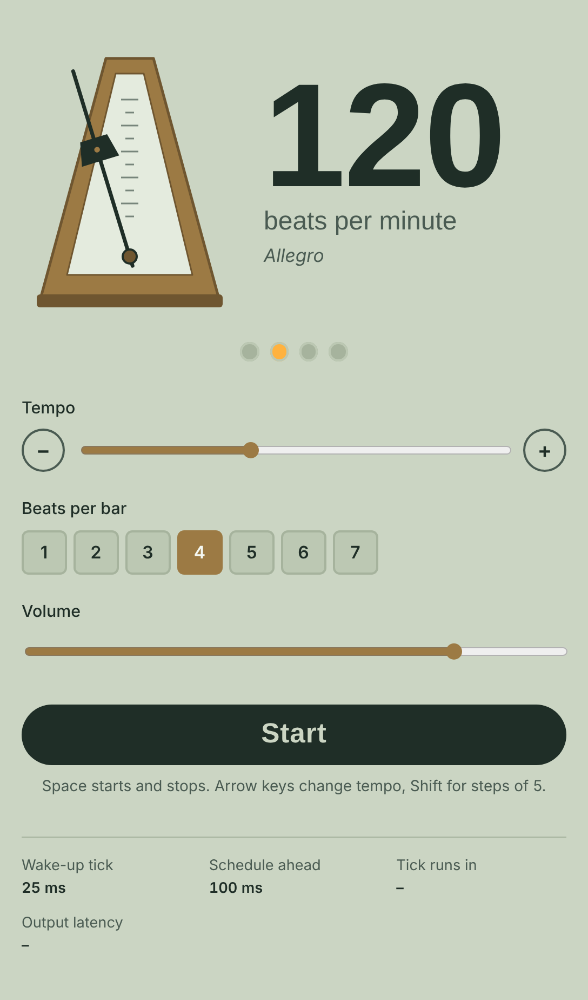

# yet-another-metronome
JavaScript metronome with 2-clock Web Audio scheduling for minimal jitter

# Metronome

A browser metronome that keeps sample-accurate time by scheduling clicks on the Web Audio clock, with an SVG pendulum that swings in step with the sound.

Open `index.html` in any modern browser. It is a single file with no build step and no dependencies.

**Controls:** Space starts and stops. Arrow keys change the tempo by 1 BPM, or by 5 with Shift. The slider covers 30–260 BPM, and you can set 1–7 beats per bar; the first beat of each bar has a higher click.

## How it keeps time: two clocks

JavaScript timers (`setInterval`, `setTimeout`) are imprecise. They fire late whenever the main thread is busy with layout, garbage collection or event handlers, and background tabs throttle them heavily. The audio hardware clock exposed as `AudioContext.currentTime` is precise but cannot call your code. The metronome uses each clock for what it is good at:

1. **The timer clock only wakes the scheduler.** A Web Worker fires a `tick` every 25 ms. It never plays sound, so a late tick does not mean a late click.
2. **The scheduler looks ahead on the audio clock.** On each tick, it queues every click whose time falls before `currentTime + 0.1`, using `AudioBufferSourceNode.start(time)`. The audio thread then plays each click at exactly that time.
3. **The window absorbs stalls.** With a 100 ms window and a 25 ms tick, the main thread can stall for roughly 75 ms before any click risks being scheduled late.

The diagram follows one beat at 120 BPM. A main-thread stall swallows the ticks at 425 and 450 ms, but the late scheduler run at 470 ms still queues the 500 ms click with 30 ms to spare, so it plays exactly on time.

```mermaid
gantt
    title Two clocks at 120 BPM (25 ms tick, 100 ms schedule-ahead)
    dateFormat x
    axisFormat %L ms

    section Worker timer
    Tick every 25 ms                         :w, 0, 700
    Tick 400                                 :milestone, t400, 400, 400
    Ticks 425 and 450 queue behind the stall :t425, 425, 450

    section Main thread
    Scheduler runs and queues click at 0     :s0, 0, 4
    Garbage collection or layout stall       :crit, stall, 400, 470
    Late run still queues click at 500       :active, s1, 470, 474

    section Lookahead window
    Window at 0 covers 0 to 100              :lw0, 0, 100
    Window at 400 stops short of 500         :lw1, 400, 500
    Window at 470 reaches 570                :lw2, 470, 570

    section AudioContext clock
    Beat 1 click at 0                        :a0, 0, 40
    Beat 2 click at 500, sample-accurate     :a1, 500, 540

    section Speakers and screen
    Beat 2 heard after output latency        :h1, 520, 560
    Rod drawn at the end of its swing        :milestone, v1, 520, 520
```

### Keeping the pendulum in sync

Each time the scheduler queues a click, it also pushes `{ beat, time }` onto a visual queue. A `requestAnimationFrame` loop drains that queue against the time currently reaching the speakers, not against `currentTime`. It gets that time from `getOutputTimestamp()`, and falls back to `currentTime − outputLatency` where that is unavailable. Without the correction, the pendulum would run ahead of the sound by the output latency, which is very noticeable on Bluetooth.

Each click lands when the rod is at one end of its swing, as on a mechanical metronome. Between two clicks, the rod's angle is `SWING × cos(π × phase)`, where the phase comes from the two scheduled click times. Tempo changes therefore stay smooth and in step with the audio.

## Tuning

| Constant | Value | Role |
| --- | --- | --- |
| `TICK_MS` | 25 ms | How often the worker wakes the scheduler |
| `SCHEDULE_AHEAD` | 0.1 s | How far past `currentTime` clicks are queued |
| `SWING` | 24° | Pendulum amplitude either side of centre |

The window must exceed the tick interval plus the worst main-thread stall you expect. Lowering the tick below about 10 ms does not help much. Browsers clamp repeating timers to about 4 ms anyway, and stalls of 50–200 ms dominate regardless of tick rate. A smaller window makes tempo changes take effect sooner, at the cost of less protection against stalls.

## Known limits

- `outputLatency` is reported by the browser and the operating system. Bluetooth devices often underreport it, so the pendulum can still look slightly early on them.
- The frame drawn in `requestAnimationFrame` reaches the screen one or two frames later, about 16–33 ms at 60 Hz. This is not compensated.
- If a Web Worker cannot be created, for example under a strict content security policy, the tick falls back to a main-thread `setInterval`. That timer is throttled in background tabs.